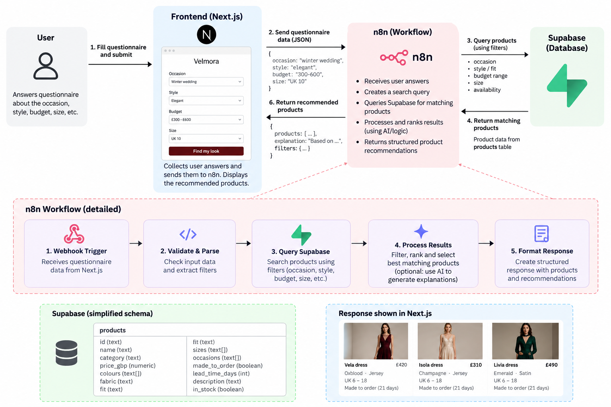

# Velmora: GIS Analytics Assessment

## Approach

### Stage 0: Project setup
I started by getting familiar with the brief and the brand, then planned the project structure. I set up the directory layout, initialised a Git repository and created a Python environment for the analysis.

### Stage 1: Data analysis
I analysed `analytics.csv` in Jupyter notebooks, using ChatGPT and Claude Code to help build the charts. The charts show how visitors move through the funnel (sessions, product views, add to cart, checkout, order) by channel and device, and where they drop off.

### Stage 2: Why visitors don't buy
The analysis shows that many visitors reach the site but few complete a purchase. The data alone cannot explain why. To fill that gap, I used the Baymard Institute's published list of the most common reasons for cart abandonment ([source](https://baymard.com/lists/cart-abandonment-rate)). I then checked which of these issues might apply to Velmora's site and used them as hypotheses for the improvements in the plan.

### Stage 3: Website
I generated the first version of the site with Base44, then exported the code and rebuilt it as a Next.js project. I chose Next.js because it:
- gives me full control over the code, instead of depending on a generator's hosted environment
- provides routing, server-side rendering and API routes out of the box, which suits product pages and the AI feature
- improves page speed and SEO, which matters because most visitors arrive on phones
- is easy to connect to Supabase and to deploy

### Stage 4: Product data
Products are stored in Supabase, and the website reads them from there, so the catalogue is no longer hardcoded in the front end.

### Stage 5: AI assistant
I built the assistant as an n8n workflow connected to Supabase. The flow is:
1. The website asks the shopper a few questions (occasion, size, delivery date and so on).
2. The website sends the answers to n8n as JSON.
3. n8n matches them against the products in Supabase.
4. n8n returns the result to the website, which displays the recommendations.

## Repository structure

| Folder | Contents |
|---|---|
| `gis-analytics-assessment-materials` | The brief and source files supplied by the employer |
| `stage-1` | Data analysis notebooks (`.ipynb`) with the charts |
| `stage-2` | Research into why visitors don't convert |
| `velmora` | The website (Next.js) |
| `n8n` | n8n workflow export and the Yaak API request collection |
| `supabase` | SQL files run in the Supabase project |